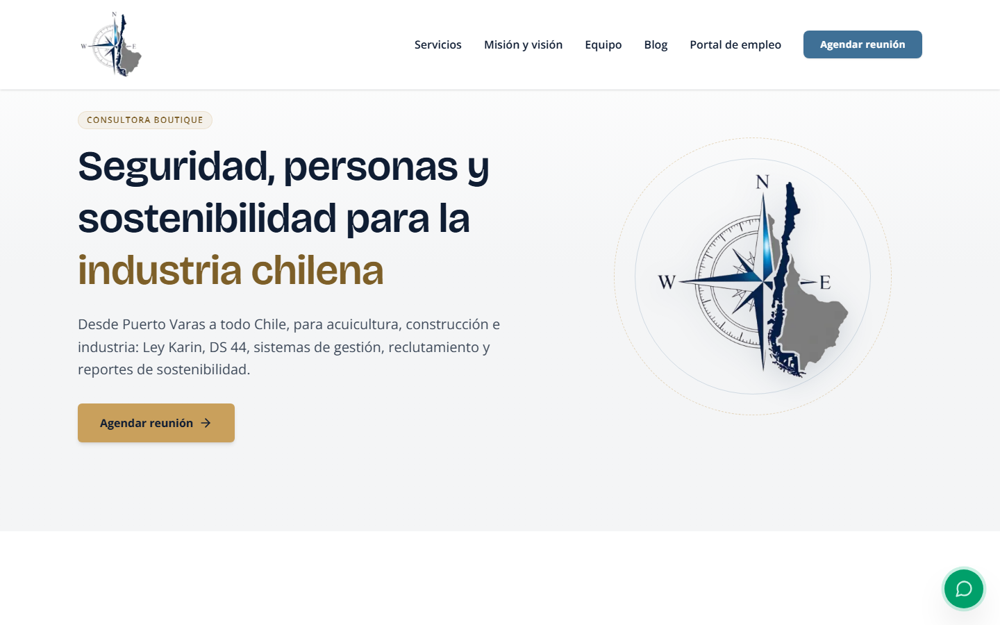
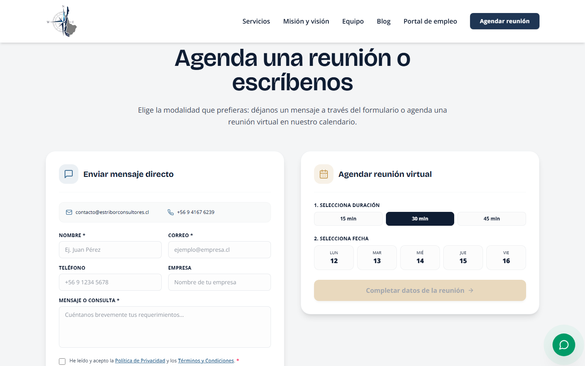
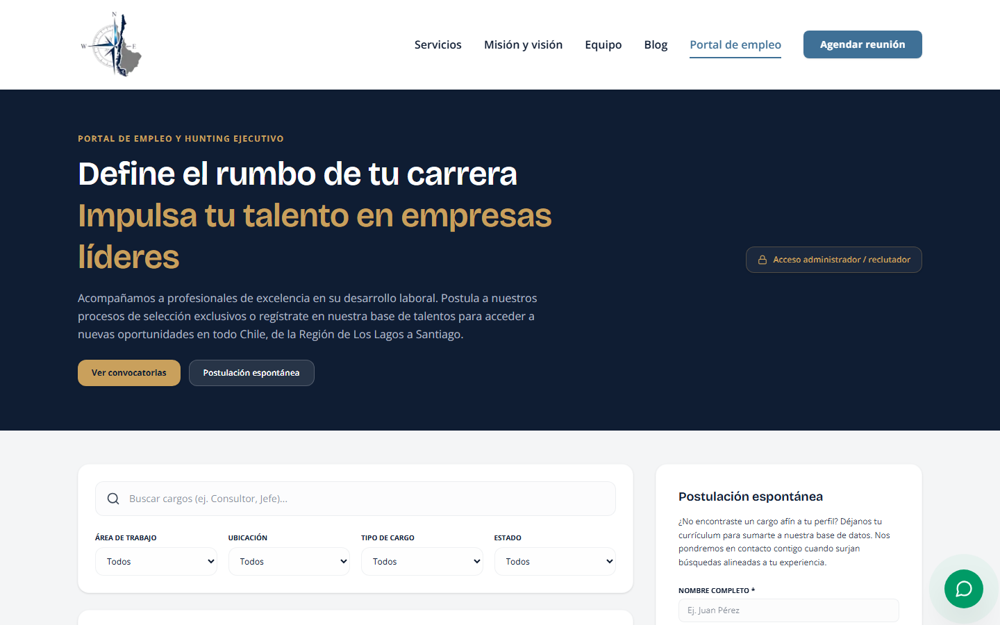
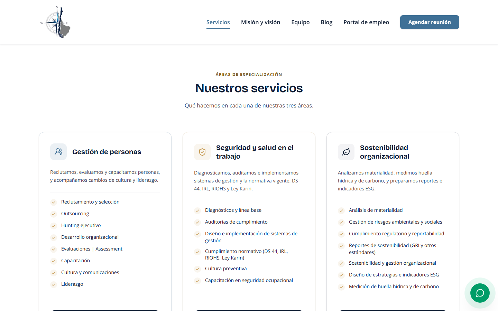
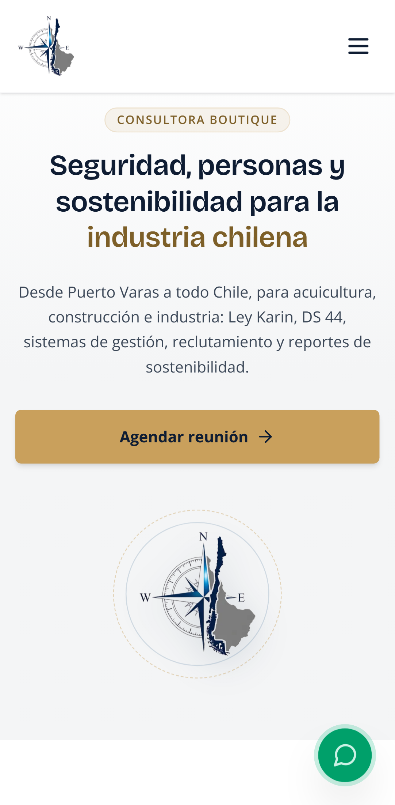

# Estribor Consultores · Sitio web

> Sitio corporativo, portal de empleo y agenda de reuniones de una consultora chilena en gestión de personas, seguridad laboral y sostenibilidad.


**Sitio en producción:** [www.estriborconsultores.cl](https://www.estriborconsultores.cl)

<p align="center">
  
</p>

---

## Índice

- [Capturas](#capturas)
- [¿Qué problema resuelve?](#qué-problema-resuelve)
- [Características principales](#características-principales)
- [Tecnologías](#tecnologías)
- [Requisitos previos](#requisitos-previos)
- [Instalación paso a paso](#instalación-paso-a-paso)
- [Uso](#uso)
- [Estructura del proyecto](#estructura-del-proyecto)
- [Configuración (`.env`)](#configuración-env)
- [Despliegue en Vercel](#despliegue-en-vercel)
- [Seguridad y datos](#seguridad-y-datos)
- [Roadmap](#roadmap)
- [Cómo contribuir](#cómo-contribuir)
- [Licencia](#licencia)
- [Autoría](#autoría)

---

## Capturas

| Agenda de reuniones y contacto | Portal de empleo |
| --- | --- |
|  |  |

| Servicios | Inicio en móvil |
| --- | --- |
|  |  |

> Capturas del sitio en producción tomadas en octubre de 2026. El panel de administración no se muestra porque requiere iniciar sesión.

---

## ¿Qué problema resuelve?

[Estribor Consultores SpA](https://www.estriborconsultores.cl) es una consultora boutique con oficina en Puerto Varas (Región de Los Lagos) que atiende empresas de todo Chile en tres ejes:

1. **Gestión de Personas:** reclutamiento y selección, hunting, desarrollo organizacional, capacitación, cultura y liderazgo.
2. **Seguridad y Salud en el Trabajo:** diagnósticos, auditorías, sistemas de gestión y cumplimiento normativo (DS 44, IRL, RIOHS, Ley Karin).
3. **Sostenibilidad Organizacional:** materialidad, reportabilidad GRI, indicadores ESG, huella hídrica y de carbono.

Una empresa que llega al sitio suele tener un problema concreto y con plazo (una norma nueva, una fiscalización, un cargo difícil de llenar). Este proyecto le permite, en un solo lugar:

- entender qué hace Estribor y quiénes la atenderían,
- **agendar una reunión** o escribir por el formulario de contacto,
- y, si es postulante, **postular a una vacante** del portal de empleo.

Al equipo de Estribor le entrega un **panel interno** para publicar vacantes y revisar postulaciones sin depender de herramientas externas.

---

## Características principales

### Sitio público

- **Páginas institucionales:** inicio, servicios, misión y visión, equipo, contacto, privacidad y términos.
- **Blog** con filtro en el cliente, artículos estáticos, imagen Open Graph por artículo y botón para compartir. El contenido vive en `lib/content/blog.ts`.
- **Formulario de contacto** que envía un correo al equipo (validación con zod, campo trampa *honeypot* contra bots y límite de solicitudes por IP).
- **Agenda de reuniones virtuales:**
  - días hábiles de las próximas semanas, en zona horaria de Chile (`America/Santiago`);
  - horarios fijos (09:00, 10:30, 12:00, 14:30, 16:00, 17:30) y duración a elegir (15, 30 o 45 min);
  - objetivo de la reunión (consultoría general, RR.HH., SST, Ley Karin, ESG);
  - impide reservar dos veces el mismo horario (índice único en la base de datos);
  - correo de confirmación y descarga del evento en formato `.ics` para el calendario.
- **Widget de WhatsApp** flotante.
- **Banner de cookies:** la analítica (Microsoft Clarity, Vercel Analytics y Speed Insights) solo se carga si la persona acepta, y puede retirar el consentimiento desde el footer.

### Portal de empleo (`/vacantes`)

- Listado de vacantes activas con filtros, generado en el servidor y regenerado cada 5 minutos (ISR).
- Página de detalle por vacante con **datos estructurados `JobPosting`** para Google for Jobs, región de Chile y fecha de cierre.
- Postulación con CV en PDF (máx. 5 MB, se valida que sea realmente un PDF) y validación de RUT chileno.
- **Postulación espontánea** para quienes no encuentran una vacante que les calce.
- Botones para compartir la vacante.

### Panel de administración (`/vacantes/admin`)

- Login con Supabase Auth y **dos roles**: `admin` y `recruiter` (reclutador).
- Crear y editar vacantes (área, región, fecha de cierre, estado activo). Solo `admin` puede borrarlas.
- Gestionar áreas de trabajo. Solo `admin` puede borrarlas.
- Revisar postulaciones con filtros, abrir CVs mediante enlaces firmados que expiran en 2 minutos y **exportar a Excel (.xlsx)**. Solo `admin` puede borrar postulaciones.
- Cambio de contraseña desde el panel.

### SEO, accesibilidad y calidad

- `sitemap.xml`, `robots.txt` (los despliegues de *preview* se bloquean con `Disallow: /`), metadata y JSON-LD por página.
- Cabeceras de seguridad (CSP, HSTS, X-Frame-Options, Referrer-Policy, Permissions-Policy).
- Pruebas unitarias de las rutas `/api` y pruebas E2E en escritorio y móvil, con auditoría de accesibilidad automática (axe).

---

## Tecnologías

| Área | Herramienta |
| --- | --- |
| Framework | [Next.js 16](https://nextjs.org) (App Router, Server Components, ISR) |
| UI | React 19, Tailwind CSS 4, Framer Motion, Lucide (iconos) |
| Lenguaje | TypeScript 5 |
| Validación | Zod 4 |
| Base de datos, login y archivos | [Supabase](https://supabase.com) (Postgres con RLS, Auth, Storage) |
| Correo | [Resend](https://resend.com) (vía API HTTP) |
| Exportación | `write-excel-file` (Excel en el navegador) |
| Analítica | Vercel Analytics, Vercel Speed Insights, Microsoft Clarity (con consentimiento) |
| Pruebas | Vitest (unitarias), Playwright + `@axe-core/playwright` (E2E y accesibilidad) |
| Calidad | ESLint 9 (`eslint-config-next`) |
| Hosting | [Vercel](https://vercel.com) (incluye un cron job) |

---

## Requisitos previos

Antes de empezar necesitas:

- **Node.js 20.9 o superior** (incluye `npm`). Comprueba tu versión con `node -v`. Si no lo tienes, descárgalo desde [nodejs.org](https://nodejs.org) (versión LTS).
- **Git**, para clonar el repositorio.
- **Una cuenta de Supabase** con un proyecto creado (el plan gratuito sirve).
- **Una cuenta de Resend** con una API key. Para enviar correos en producción necesitas un dominio verificado.
- *(Opcional)* Una cuenta de Vercel para desplegar.

---

## Instalación paso a paso

### 1. Clona el repositorio

```bash
git clone https://github.com/diegocabre/estribor.git
```

```bash
cd estribor
```

### 2. Instala las dependencias

```bash
npm install
```

### 3. Crea tu archivo de variables de entorno

Copia la plantilla `.env.example` como `.env.local`:

```bash
cp .env.example .env.local
```

> En Windows con PowerShell usa `Copy-Item .env.example .env.local`.

Abre `.env.local` y completa los valores. La sección [Configuración](#configuración-env) explica cada variable y dónde conseguirla.

### 4. Prepara Supabase

El código usa estas tablas y este bucket en Supabase:

| Recurso | Para qué |
| --- | --- |
| Tabla `jobs` | Vacantes del portal |
| Tabla `job_areas` | Áreas de trabajo de las vacantes |
| Tabla `applications` | Postulaciones |
| Tabla `bookings` | Reservas de la agenda |
| Bucket `cvs` (privado) | CVs en PDF |

> **[PENDIENTE]** El repositorio **no incluye el SQL que crea estas tablas**: las migraciones de `supabase/migrations/` asumen que ya existen y solo agregan seguridad y columnas nuevas. Para instalar desde cero hace falta un script con el esquema inicial.

Con las tablas creadas, aplica las migraciones en orden. Puedes pegarlas en el **SQL Editor** de Supabase o usar la CLI:

```bash
supabase db push
```

1. `20261001120000_rls_y_seguridad.sql` — activa RLS, deja como única política pública la lectura de vacantes activas, crea el índice único `(date, time)` en `bookings` y vuelve privado el bucket `cvs`. **Léela antes de aplicarla:** ejecuta primero las consultas de verificación de su sección 0 y asigna los roles del panel (sección 7).
2. `20261011120000_jobs_closes_at.sql` — agrega la fecha de cierre a las vacantes.
3. `20261011130000_jobs_region.sql` — agrega la región a las vacantes.

Por último, en Supabase ve a **Authentication → Providers → Email** y **desactiva el registro público**: las cuentas del panel se crean a mano.

Para comprobar que copiaste bien la clave de servicio (sin mostrarla en pantalla):

```bash
node scripts/check-supabase-key.mjs
```

### 5. Levanta el servidor de desarrollo

```bash
npm run dev
```

Abre [http://localhost:3000](http://localhost:3000). Si ves la página de inicio, ¡listo!

---

## Uso

### Comandos disponibles

| Comando | Qué hace |
| --- | --- |
| `npm run dev` | Servidor de desarrollo en `http://localhost:3000`. |
| `npm run build` | Compila para producción. |
| `npm start` | Sirve la versión compilada (después de `build`). |
| `npm run lint` | Revisa el código con ESLint. |
| `npm run typecheck` | Revisa los tipos de TypeScript sin generar archivos. |
| `npm test` | Pruebas unitarias y de rutas `/api` con Vitest. Supabase y Resend están simulados: no necesitas credenciales. |
| `npm run test:watch` | Igual que el anterior, pero se repite al guardar cambios. |
| `npm run test:e2e` | Pruebas E2E y de accesibilidad con Playwright, en escritorio (Chrome) y móvil (Pixel 7). |
| `node tests/e2e/axe-report.mjs [url]` | Informe de accesibilidad WCAG 2.1 AA de todas las páginas. |

La primera vez que corras las pruebas E2E instala el navegador:

```bash
npx playwright install chromium
```

Las pruebas E2E levantan `next dev` en el puerto **3100** e interceptan las llamadas a `/api/*`, así que **no envían correos ni escriben en Supabase**. Para probar contra un sitio ya desplegado, define `E2E_BASE_URL`.

### Entrar al panel de administración

1. Crea un usuario en Supabase (**Authentication → Users → Add user**).
2. Dale un rol de una de estas dos formas:
   - en `app_metadata.role` del usuario, con el valor `admin` o `recruiter` (la migración de seguridad muestra cómo, en su sección 7), o
   - agregando su correo a `ADMIN_EMAILS` o `RECRUITER_EMAILS` en `.env.local`.
3. Entra a [http://localhost:3000/vacantes/admin](http://localhost:3000/vacantes/admin) con ese correo y contraseña.

Sin rol asignado, nadie puede entrar al panel.

### Ejemplos de la API

Las rutas `/api` las usan los formularios del sitio, pero puedes probarlas con `curl` mientras corre `npm run dev`.

**Ver los horarios ya reservados** (solo devuelve fecha y hora, nunca datos personales):

```bash
curl http://localhost:3000/api/agenda
```

```json
{ "success": true, "bookings": [{ "date": "Lunes, 12 de Octubre de 2026", "time": "10:30" }] }
```

**Descargar una reunión como evento de calendario (`.ics`):**

```bash
curl -o reunion.ics "http://localhost:3000/api/agenda?download=ics&dateStr=2026-10-14&time=10:30&duration=30%20min"
```

**Enviar el formulario de contacto** (envía un correo real si configuraste Resend):

```bash
curl -X POST http://localhost:3000/api/contacto -H "Content-Type: application/json" -d '{"name":"Ana Pérez","email":"ana@empresa.cl","message":"Necesitamos implementar el protocolo de la Ley Karin.","privacyAccepted":true}'
```

Cada ruta tiene un límite de solicitudes por IP. Por ejemplo, la agenda acepta 3 reservas cada 10 minutos por IP; si lo superas responde `429`.

### Editar contenido sin tocar la base de datos

| Qué cambiar | Archivo |
| --- | --- |
| Artículos del blog | `lib/content/blog.ts` |
| Equipo (nombre, cargo, biografía, foto) | `lib/content/team.ts` y `public/images/team/` |
| Teléfono, correo, RUT y datos legales | `lib/legalConfig.ts` |
| Horarios, duraciones y objetivos de la agenda | `lib/agenda.ts` |
| Regiones disponibles para las vacantes | `lib/regions.ts` |

---

## Estructura del proyecto

```
.
├── app/                         Rutas de Next.js (App Router)
│   ├── page.tsx                 Inicio
│   ├── servicios/ mision-vision/ equipo/ contacto/ privacidad/ terminos/
│   ├── blog/                    Listado y artículos ([slug]) con imagen Open Graph
│   ├── vacantes/                Portal de empleo (ISR, revalidate 300 s)
│   │   ├── [id]/                Detalle de vacante + JSON-LD JobPosting
│   │   └── admin/               Panel interno: _components/, _hooks/, _lib/
│   ├── api/
│   │   ├── contacto/            Formulario de contacto → correo
│   │   ├── agenda/              Disponibilidad, reservas y descarga .ics
│   │   ├── postulaciones/       Postulaciones con CV (bucket privado)
│   │   ├── admin/               applications, areas, cv, data, jobs (valida JWT y rol)
│   │   └── cron/keepalive/      Consulta liviana para que Supabase Free no se pause
│   ├── layout.tsx, globals.css
│   └── sitemap.ts, robots.ts, opengraph-image.tsx, not-found.tsx
├── components/                  Secciones del sitio y piezas interactivas
│   ├── agenda/                  Calendario y formulario de reserva
│   ├── contacto/  vacantes/  blog/  footer/
│   ├── seo/JsonLd.tsx  analytics/ConsentAnalytics.tsx  ui/Reveal.tsx
│   └── Header, Hero, Footer, CookieBanner, WhatsAppWidget, …
├── lib/
│   ├── types.ts                 Tipos de dominio
│   ├── agenda.ts                Reglas de la agenda (zona horaria de Chile)
│   ├── validation.ts            Esquemas zod (contacto, reserva, postulación, RUT, PDF)
│   ├── security.ts              Escape HTML, rate limit, errores sin filtrar detalles
│   ├── email.ts                 Envío con Resend y plantillas
│   ├── supabase.ts              Cliente público (clave anon)
│   ├── supabase-admin.ts        Cliente de servicio (solo servidor)
│   ├── admin-auth.ts            Sesión y rol del panel
│   ├── jobs.ts, job-dates.ts, regions.ts
│   ├── seo.ts, og-image.tsx, analytics.ts, legalConfig.ts
│   └── content/                 blog.ts, team.ts
├── public/                      Logo e imágenes del equipo
├── scripts/check-supabase-key.mjs  Verifica la clave de servicio sin mostrarla
├── supabase/migrations/         SQL versionado (RLS, políticas, índices, columnas)
├── tests/
│   ├── unit/                    Vitest (rutas /api, agenda, validación, fechas)
│   └── e2e/                     Playwright + axe (contacto, reserva, accesibilidad)
├── next.config.ts               Cabeceras de seguridad y CSP
├── vercel.json                  Cron de keepalive
├── playwright.config.ts, vitest.config.mts, eslint.config.mjs
├── PRODUCT.md                   Contexto de negocio, tono y reglas de contenido
└── .env.example                 Plantilla de variables de entorno
```

> Antes de agregar texto al sitio, lee `PRODUCT.md`: define el tono y qué afirmaciones (cifras, clientes, cobertura) **no** se pueden publicar sin respaldo.

---

## Configuración (`.env`)

Las variables se leen desde `.env.local` (que está en `.gitignore` y nunca se sube a git).

> ⚠️ Las variables que empiezan con `NEXT_PUBLIC_` llegan al navegador y cualquiera puede verlas. **Nunca pongas secretos en ellas.**

| Variable | Dónde se usa | ¿Obligatoria? | Descripción y dónde conseguirla |
| --- | --- | --- | --- |
| `NEXT_PUBLIC_SUPABASE_URL` | Cliente y servidor | Sí | URL del proyecto. Supabase → Project Settings → API. |
| `NEXT_PUBLIC_SUPABASE_ANON_KEY` | Cliente y servidor | Sí | Clave pública. Solo lee vacantes publicadas (RLS) y maneja el login del panel. |
| `SUPABASE_SERVICE_ROLE_KEY` | Solo servidor | Sí | Clave de servicio (ignora RLS). La usan las rutas `/api`. Verifícala con `node scripts/check-supabase-key.mjs`. |
| `RESEND_API_KEY` | Solo servidor | Sí | API key de Resend. |
| `RESEND_FROM_EMAIL` | Solo servidor | Sí en producción | Remitente con dominio verificado, p. ej. `Estribor Consultores <contacto@estriborconsultores.cl>`. |
| `NOTIFICATION_RECIPIENT_EMAIL` | Solo servidor | No | Casilla que recibe contactos y reservas. Por defecto `contacto@estriborconsultores.cl`. |
| `ADMIN_EMAILS` | Solo servidor | No* | Correos con rol administrador, separados por coma. |
| `RECRUITER_EMAILS` | Solo servidor | No* | Correos con rol reclutador, separados por coma. |
| `CRON_SECRET` | Solo servidor | Sí en Vercel | Secreto del cron de keepalive. Genera uno con `openssl rand -hex 32`. |
| `NEXT_PUBLIC_SITE_URL` | Cliente y servidor | Sí | URL canónica: `https://www.estriborconsultores.cl` (en local puedes usar `http://localhost:3000`). |
| `NEXT_PUBLIC_CLARITY_PROJECT_ID` | Cliente | No | ID de Microsoft Clarity. Solo se carga si la persona acepta las cookies analíticas. |
| `NEXT_PUBLIC_GOOGLE_SITE_VERIFICATION` | Cliente | No | Código de verificación de Google Search Console. |

\* El rol del panel se toma primero de `app_metadata.role` en Supabase Auth. Las listas de correos son un respaldo: si no usas ninguna de las dos opciones, nadie puede entrar al panel.

Variables opcionales para las pruebas E2E: `E2E_PORT` (por defecto `3100`) y `E2E_BASE_URL` (prueba contra un sitio ya levantado).

---

## Despliegue en Vercel

1. Importa el repositorio en Vercel (framework: Next.js, comandos por defecto).
2. En **Settings → Environment Variables** carga todas las variables de la tabla, en *Production* y *Preview*. `SUPABASE_SERVICE_ROLE_KEY`, `RESEND_API_KEY` y `CRON_SECRET` van solo como variables de servidor (sin prefijo `NEXT_PUBLIC_`).
3. Despliega. `vercel.json` registra el cron `/api/cron/keepalive` cada 3 días a las 12:00 UTC, para que el proyecto gratuito de Supabase no se pause por inactividad. Vercel envía `Authorization: Bearer $CRON_SECRET` automáticamente.
4. Recomendado en Vercel Pro: **Firewall → Rate limiting** para `/api/contacto`, `/api/agenda` y `/api/postulaciones` (p. ej. 10 solicitudes por minuto por IP). El límite en memoria del código es solo una primera barrera por instancia.
5. Verifica en producción: envía un contacto de prueba, revisa `https://www.estriborconsultores.cl/sitemap.xml` y valida una vacante en la [Prueba de resultados enriquecidos](https://search.google.com/test/rich-results) de Google.

---

## Seguridad y datos

- Toda escritura sensible pasa por rutas `/api` del servidor con `SUPABASE_SERVICE_ROLE_KEY`. El navegador solo usa la clave anon para leer vacantes publicadas y para el login.
- Las rutas `/api/admin/*` validan el JWT de Supabase y el rol **en el servidor**; borrar vacantes, áreas o postulaciones exige rol `admin`.
- Los CVs se guardan en el bucket privado `cvs` con nombre UUID; el panel los abre con URLs firmadas de 2 minutos.
- Las respuestas de error no exponen detalles internos, y los textos que van en correos se escapan contra inyección de HTML.
- El panel (`/vacantes/admin`) y la API se sirven con `no-store` y `noindex`.

---

## Roadmap

Pendientes que se desprenden del propio código y de `PRODUCT.md`:

- [ ] Agregar al repositorio el SQL del **esquema inicial** (`jobs`, `job_areas`, `applications`, `bookings` y bucket `cvs`) para poder instalar desde cero.
- [ ] Hacer que `components/WhatsAppWidget.tsx` lea el teléfono desde `lib/legalConfig.ts` (hoy lo tiene escrito en el propio archivo).
- [ ] Publicar casos y testimonios de clientes cuando existan y estén autorizados (`PRODUCT.md`, sección *Evidence on Hand*).
- [ ] Automatizar lint, typecheck y pruebas en CI (no hay workflows de GitHub Actions en el repositorio).

> **[PENDIENTE]** Si hay funcionalidades planificadas que no están en el código, agrégalas aquí.

---

## Cómo contribuir

¡Las contribuciones son bienvenidas! Puedes reportar errores o proponer mejoras abriendo un [issue](https://github.com/diegocabre/estribor/issues), o enviar código con un pull request.

> El código no tiene licencia abierta (ver [Licencia](#licencia)). Al enviar una contribución aceptas que se incorpore al proyecto bajo esas mismas condiciones.

Pasos para contribuir con código:

1. Haz un *fork* del repositorio y crea una rama desde `main`:

   ```bash
   git checkout -b mi-cambio
   ```

2. Haz tus cambios. Respeta el tono y las reglas de contenido de `PRODUCT.md` (español de Chile, sin cifras ni clientes inventados).
3. Antes de abrir el pull request, comprueba que todo pase:

   ```bash
   npm run lint
   ```

   ```bash
   npm run typecheck
   ```

   ```bash
   npm test
   ```

   ```bash
   npm run test:e2e
   ```

4. Escribe mensajes de commit claros, en español, que expliquen qué cambia y por qué (por ejemplo: `Vacantes: fecha de cierre por vacante en el panel y en el JobPosting`).
5. Abre un pull request hacia `main` describiendo el cambio y cómo lo probaste.

**Nota sobre Next.js 16:** esta versión trae cambios de API respecto de versiones anteriores. Antes de escribir código, revisa la guía correspondiente en `node_modules/next/dist/docs/` (ver `AGENTS.md`).

---

## Licencia

**© 2026 Diego Cabré. Todos los derechos reservados.**

Este código es propietario. Puedes verlo y proponer cambios en este repositorio, pero no está permitido copiarlo, distribuirlo, modificarlo para otros fines ni usarlo en otros proyectos sin autorización escrita. Los detalles están en [LICENSE](LICENSE).

El nombre, el logo y los contenidos de Estribor Consultores son propiedad de Estribor Consultores SpA.

---

## Autoría

- **Desarrollo:** Diego Cabré · [@diegocabre](https://github.com/diegocabre)
- **Cliente:** Estribor Consultores SpA · Puerto Varas, Región de Los Lagos, Chile · [contacto@estriborconsultores.cl](mailto:contacto@estriborconsultores.cl)
